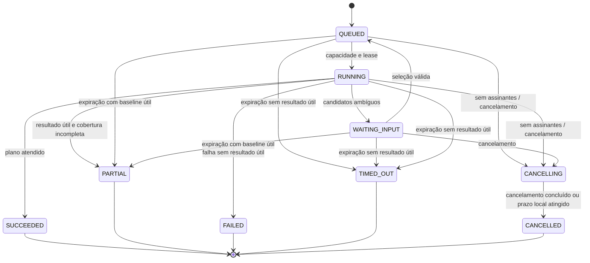

# Orquestração, estados, conexões e orçamento

## 1. Invariantes

1. Toda execução tem plano versionado, prazo absoluto, limites e reservas antes do primeiro despacho remoto.
2. O backend toma decisões por estado persistido, não pela existência de um socket.
3. Uma etapa pode reutilizar resultado, executar, falhar ou ser dispensada com motivo. Nenhuma etapa reinicia indefinidamente.
4. Retry, polling, reconnect e recuperação de worker consomem os limites existentes; não renovam orçamento nem prazo.
5. Finalização é monotônica. Escrita tardia de worker antigo não altera snapshot ou estado terminal.
6. Falha opcional não elimina conhecimento já confirmado. Incerteza de consumo não é tratada como consumo zero.

## 2. Máquina de estados da execução

A definição legível por máquina está em [discovery-state-machine.json](discovery-state-machine.json). Os eventos abaixo são eventos de domínio do produto.



Em `CANCELLING`, o cancelamento remoto pode continuar desconhecido. `CANCELLED` significa que o produto parou de despachar e publicar trabalho para essa execução; o campo `remoteOutcome` informa se o fornecedor confirmou interrupção. Não significa estorno de consumo.

Estado da etapa: `PENDING`, `RUNNING`, `SUCCEEDED`, `REUSED`, `SKIPPED`, `FAILED`, `CANCELLED`. `SKIPPED` tem motivo, por exemplo `NO_GAPS`, `NOT_SUPPORTED`, `BUDGET_NOT_CONFIGURED`; falha de uma etapa prometida não vira `SKIPPED` para esconder cobertura incompleta.

Erro com snapshot útil é normalizado para o evento `INCOMPLETE`; `ERROR` termina em `FAILED` somente quando não existe resultado útil. Razão e fonte do erro permanecem registradas nos dois casos.

O watchdog avalia todos os limites, gerando `DEADLINE_EXCEEDED` com `deadlineKind=QUEUE|INPUT|ACTIVE|ABSOLUTE` e a razão correspondente. Rejeição definitiva de orçamento/quota gera `BUDGET_REJECTED`, com `PARTIAL` se há snapshot útil ou `FAILED` sem ele; não espera inutilmente a fila expirar. Limite atingido durante trabalho gera `LIMIT_REACHED` com a mesma regra. Não admitir `WAITING_INPUT` enquanto houver operação remota em andamento.

Estado da sessão: `CREATED`, `QUEUED`, `RUNNING`, `WAITING_INPUT`, `CANCELLING`, `SUCCEEDED`, `PARTIAL`, `FAILED`, `TIMED_OUT`, `CANCELLED`. Uma sessão satisfeita somente por cache pode ir de `CREATED` para `SUCCEEDED` sem execução remota. Sessões associadas acompanham a execução até sua própria conclusão/desassociação. Um snapshot anterior é baseline; `PARTIAL` informa que o pedido de atualização não foi integralmente atendido.

`SUCCEEDED` exige todas as etapas obrigatórias satisfeitas e nenhuma limitação que comprometa a cobertura prometida. Enriquecimento opcional legitimamente desabilitado não impede sucesso. Se estava habilitado no plano e falhou, o resultado é `PARTIAL` com topologia preservada.

## 3. Limites iniciais do piloto

Configuração proposta em [discovery-policy.example.json](discovery-policy.example.json). Os valores abaixo não são limites do Dynatrace e serão calibrados com dados reais.

| Dimensão | Limite proposto | Ao atingir |
| --- | --- | --- |
| Tempo total absoluto | 750 s desde criação do run | Encerrar; sem renovação automática |
| Tempo ativo acumulado | 120 s, incluindo chamadas e processamento | Cancelar pendências e finalizar parcial/timeout |
| Espera acumulada em fila | 30 s | Parcial se há baseline útil, senão timeout |
| Espera por seleção | 600 s; no máximo uma espera por run | Liberar recursos enquanto aguarda; expirar visivelmente |
| Um request HTTP / tool invocation | Até 20 s, dentro do saldo do run | Cancelar/recuperar estado; não repetir resultado desconhecido |
| Uma query assíncrona lógica | Até 30 s incluindo polls, dentro do saldo ativo | Cancelar ou marcar outcome desconhecido |
| Graça de cancelamento | Até 5 s, limitada por `deadlineAt + 5 s` | Finalizar localmente mesmo sem confirmação remota |
| Enriquecimento MCP | 30 s no total; até 2 invocações | Encerrar enriquecimento sem bloquear entrega |
| HTTP ao fornecedor | 60 requests, incluindo poll, cancel e controle | Parar despachos normais; reservar margem para cleanup |
| Cleanup | Até 4 dos 60 requests reservados para cancel/cleanup | Após margem, registrar outcome desconhecido e bloquear reenvio |
| Execuções de query | 6, contabilizando MCP que dispare query | Não despachar nova consulta |
| Poll | Até 10 por query, intervalo 2–5 s com jitter | Recuperar/cancelar ou marcar outcome desconhecido |
| Scan de telemetria | 500.000.000 bytes por run; 100.000.000 por fetch | Converter para a unidade do fornecedor somente após homologação |
| Retorno | 5 MiB e 1.000 registros por consulta; 8 MiB de resposta descomprimida local | Registrar truncamento; abortar leitura/parsing acima do teto local |
| MCP e prompts | 1 MiB por resposta descomprimida; 32 KiB por entrada de enriquecimento | Interromper/recusar sem reenvio automático |
| Grafo | 500 nós e 1.000 arestas | Preservar fronteira e propor expansão explícita |
| Concorrência | 2 runs por ambiente; 2 consultas API e 1 tool MCP por ambiente | Fila limitada e justa |
| Retry | Até 1 adicional por operação elegível | Deadline e orçamento continuam valendo |
| Watchdog | Varredura a cada 5 s | Recuperar lease ou finalizar execução expirada |

O tempo ativo é tempo de parede acumulado em estado de trabalho, não soma da duração de chamadas paralelas. Persistir `activeElapsedMillis`, `queuedElapsedMillis` e `deadlineAt`; usar relógio do banco para decisões distribuídas. Esperar seleção não consome tempo ativo, mas continua dentro do prazo absoluto.

`cancellationDeadlineAt = min(cancelRequestedAt + 5 s, deadlineAt + 5 s)`. A partir desse instante, `CANCELLING` deve finalizar mesmo sem ack, com publicação na próxima varredura do watchdog e a latência operacional medida. O limite local de leitura vale após descompressão e inclui metadados; impor também limites de nesting, tamanho por registro e parsing incremental. Não publicar um lote cortado no meio.

O ledger usa bytes; a unidade de `scanLimitGBytes`, granularidade e valores fracionários são verificados no spike. Se não houver configuração remota representável dentro do teto reservado, a consulta não é admitida. A política não presume que GB do fornecedor ou GiB de faturamento sejam a mesma unidade.

A finalização local deve ocorrer até `deadlineAt + 5 s + latência operacional medida`. Indisponibilidade do próprio banco/serviço pode atrasar a publicação; ao recuperar, finalizar antes de despachar qualquer trabalho. Não prometer SLA absoluto durante indisponibilidade total.

Os limites suaves do fornecedor não bastam como garantia física de consumo. Se uma ferramenta não expõe teto verificável de consulta ou IA, desabilitá-la no automático. Consultas aceitas remotamente podem continuar após falha de rede; o produto reserva esse risco e não admite duplicação automática.

## 4. Plano e scheduler

O plano contém `policyVersion`, capabilities, raiz, intervalo absoluto, baseline, DAG de etapas, fontes, query templates, limites e razões de reuso. O intervalo “última hora” é resolvido uma vez; alterações do relógio não mudam o conjunto consultado durante a execução.

Transação de criação:

1. Autorizar e normalizar entrada; resolver chave de idempotência e fronteira de visibilidade.
2. Criar sessão. Se snapshot válido cobre todo o pedido e não há pedido explícito de atualização imediata, vincular e concluir com motivo `FRESH_CACHE`.
3. Caso contrário, adquirir/associar execução elegível equivalente por operação atômica; criar plano inicial e reserva apenas para nova execução, incluindo resolução remota antes de `PLAN_REFRESH`.
4. Persistir evento de sessão/fila e confirmar. Não chamar fornecedor nessa transação.

Worker reclama item com `FOR UPDATE SKIP LOCKED`, atualiza owner, `leaseUntil` e `fencingToken` e confirma imediatamente. Executa I/O fora da transação. Ao persistir lote/etapa, exige lease, fencing token e estado válidos. Lease perdido invalida o worker para publicação.

`SKIP LOCKED` é adequado para fila, com a visão inconsistente esperada desse padrão; não deve ser usado para leitura normal de mapas. [PostgreSQL 18 — SELECT](https://www.postgresql.org/docs/18/sql-select.html).

Claim não garante exactly-once remoto. Antes de cada operação, gravar intent e reserva; após resposta, registrar token/resultado e consumo. Há uma janela inevitável entre aceitação remota e persistência do token. Em crash nessa janela, marcar `OUTCOME_UNKNOWN`, não repetir cegamente.

## 5. Reuso e cache

Chave básica:

```text
organization + dynatraceEnvironment + visibilityScopeVersion
+ normalizedApplicationScope + resolvedRootIds + interval
+ coverageRequirements + policyVersion + sourceSchemaVersion
```

Para o catálogo e o baseline estrutural, a identidade da aplicação é estável, mas a cobertura temporal acompanha o snapshot. Reutilizar um mapa antigo como baseline não significa satisfazer métricas ou evidência de rota do período novo.

O contrato distingue `CURRENT_AS_OF` e `HISTORICAL_WINDOW`. No primeiro, topologia com idade de até 15 min pode atender a tolerância declarada, com data observada visível; não afirma cobrir a cauda de tráfego até agora. No segundo, exige cobertura da janela solicitada e informa a janela efetiva do fornecedor. Saúde e atribuição por rota exigem período compatível, mesmo em modo atual. No MVP, intervalos temporais diferentes não compartilham query/resultados; reaproveitar buckets e consultar só a cauda é otimização futura com deduplicação temporal. O reuso estrutural continua útil independentemente disso.

| Camada | TTL inicial proposto | Invalidação adicional |
| --- | --- | --- |
| Vínculo URL/aplicação | 24 h | Alteração de regra, raiz ausente, confirmação corrigida |
| Topologia | 15 min | Nova raiz, escopo mais profundo, delta estrutural |
| Evidência de rota | 5 min | Janela incompatível, regra de rota alterada |
| Saúde | 2 min | Janela incompatível; não usar saúde histórica como atual |
| Oportunidades MCP | 6 h | Delta de evidências, versão de regra/prompt ou schema |
| Resultado de query | 5 min | Fingerprint/intervalo/visibilidade diferentes |
| Resultado negativo | 2 min | Nova evidência, permissão corrigida, seleção manual |
| Capabilities / catálogo MCP | 60 min / 15 min | Mudança de permissão, endpoint ou schema |

TTL é condição necessária, não suficiente. Verificar período efetivamente coberto, profundidade, tipos, truncamento, sampling e fontes. Mapas parciais podem ser baseline, mas não satisfazem cobertura completa. Não deslocar consultas para a mesma janela só para produzir cache hit sem informar a janela real.

Busca repetida: carregar baseline → atualizar somente camadas vencidas/incompatíveis → calcular delta → reavaliar MCP somente se delta/lacunas e validade exigirem. Mudanças de filtros nunca invalidam cache de coleta. Uma opção “forçar atualização” ainda usa single-flight, orçamento e limites de frequência; ela não ignora governança.

Single-flight coalesce apenas fingerprint equivalente no MVP. Cada sessão mantém associação independente. Compartilhar exige igualdade de autorização, identidade de coleta, janela e cobertura; equivalência entre fronteiras de segurança nunca é presumida. Cache em memória é aceleração; PostgreSQL preserva a decisão entre réplicas.

**Regra para ambiguidade:** somente runs cuja raiz estava confirmada na criação são compartilháveis neste MVP. Runs de resolução não confirmada permanecem exclusivos até o terminal, inclusive depois da seleção. Assim `WAITING_INPUT` nunca bloqueia outras sessões e a escolha de uma pessoa não muda a raiz da outra. Resultados de leitura de candidatos podem ser cacheados por contexto; compartilhar a descoberta depois de seleções independentes é otimização posterior. A garantia de uma execução para duas buscas concorrentes aplica-se a buscas elegíveis, com a mesma raiz confirmada.

## 6. Ledger e admissão de custo

O licenciamento diferencia AI Units, Standard Function Calls e consumo de consultas; uma ferramenta sem LLM ainda pode gerar chamadas e consultas cobradas. Preços vêm do contrato do cliente. [AI Units](https://docs.dynatrace.com/docs/license/capabilities-classic/appengine-functions/ai-units-classic), [Standard Function Calls](https://docs.dynatrace.com/docs/license/capabilities/appengine-functions/standard-function-calls).

`BudgetGate` executa antes de cada chamada:

1. Verificar estado, cancelamento, lease, tempo e quota por run/usuário/ambiente/organização.
2. Estimar limite superior conservador nas dimensões verificáveis: requests, queries, GB de scan, chamadas MCP e IA quando controlável.
3. Reservar atomicamente nos limites compartilhados. Comparar `observado + reservado + risco desconhecido` com o teto.
4. Despachar apenas se a reserva foi concedida; reconciliar observado e liberar diferença comprovada.
5. Manter reserva/risco de chamadas sem outcome e ocupação remota potencial; nunca restituir como se fossem gratuitas nem liberar concorrência remota com base apenas no timeout local. Reconciliar por confirmação, prazo remoto comprovado ou procedimento operacional explícito.

Todos os `fetch` de uma query entram no scan reservado; subqueries não ganham orçamento extra. Campo de default na API sozinho não impede override no DQL. Metadata observada orienta reconciliação; não equivale necessariamente à fatura. Ao esgotar a quota diária, novas chamadas são bloqueadas; não se renovam reservas só por trocar usuário ou sessão. Os limites diários de exemplo são 2.000 requests, 10.000.000.000 bytes de scan e 100 tools por ambiente, com reset UTC explícito.

Preço monetário só é exibido se houver rate card versionado, moeda, unidade e cobertura conhecidos. Sem isso, a tela mostra unidades técnicas e “valor financeiro não configurado”. Um teto monetário rígido não pode ser prometido para ferramenta cujo consumo interno não é controlável. Essas ferramentas ficam desabilitadas ou são restritas a fluxo manual separado, fora do MVP automático.

A política de exemplo deixa ferramentas generativas desabilitadas até homologar orçamento de IA. MCP de leitura com limites comprovados pode operar. Habilitar IA depois exige limite demonstrado por ferramenta, quota diária do ambiente e auditoria; “até duas tools” não é um teto de tokens ou AI Units.

Custos do run compartilhado são registrados uma vez. Sessões recebem referência e atribuição de uso; não duplicar o total real ao consolidar relatórios. Probes administrativos têm ledger próprio com quota pequena, nunca chamadas invisíveis fora da contabilização.

## 7. Erros, reconexão e circuit breaker

| Condição | Comportamento |
| --- | --- |
| Falha comprovadamente antes do envio | Retry limitado com jitter e reserva válida |
| Timeout após possível aceitação | Recuperar token/estado se disponível; sem reenvio automático |
| 401 | Refresh único coordenado; retry só se requisição rejeitada sem execução |
| 403 | Registrar permissão ausente; não retry |
| 429 | Respeitar `Retry-After` apenas se couber no deadline e na quota |
| 5xx/transporte | Retry só quando outcome conhecido e operação segura; caso contrário desconhecido |
| Query token recuperável | Continuar poll sob mesma identidade e limites existentes |
| Resultado expirado no fornecedor | Registrar indisponível; nova query só por nova decisão orçada |
| Schema/tool alterado | Desabilitar ferramenta afetada e degradar enriquecimento |
| MCP indisponível | Circuit breaker específico do conector, sem interromper API determinística |

Breaker proposto: abrir após 5 falhas transitórias consecutivas em até 60 s; aguardar 30 s; half-open com uma sonda por ambiente. Permissão negada não entra como indisponibilidade transitória. Esses parâmetros são calibráveis e não prorrogam runs esperando a reabertura.

Catálogo, pool HTTP e autenticação têm lifecycle separado do run. No perfil MCP antigo, respeitar inicialização, afinidade e sessão emitida; no moderno, usar semântica por request. Não tentar “consertar” todos os 404 recriando sessão. Cancelamento usa o perfil homologado; comportamento antigo não garante que o receptor pare imediatamente. [Cancelamento MCP 2025-11-25](https://modelcontextprotocol.io/specification/2025-11-25/basic/utilities/cancellation).

## 8. Cancelamento, compartilhamento e retomada

- Cancelar sessão desassocia seu interesse e fixa seu snapshot parcial em transação atômica com estado/evento. Se outros assinantes precisam do run, ele continua para eles; novas versões não alteram a sessão cancelada.
- Sem assinantes, sinalizar cancelamento do run, impedir novo despacho e tentar cancelar operações remotas com a margem reservada.
- O watchdog aplica fencing, publica terminal e preserva o que já foi validado. Resposta tardia não altera a sessão final.
- Uma resposta tardia pode reconciliar ledger e auditoria de operação, sem publicar grafo nem reabrir run.
- Fechar aba não é cancelar. A execução segue apenas até seu limite original.
- Continuar após terminal cria nova sessão e run, vinculados ao anterior; usuário escolhe escopo/orçamento. Não existe auto-resume eterno.

## 9. Observabilidade do próprio produto

Métricas: tempo até baseline e primeiro resultado novo, duração por etapa, sucesso/parcial por motivo, cache hit por camada, taxa de coalescência, calls/scan/IA por run, outcomes desconhecidos, retries, 429, breaker, clientes MCP ativos, leases expirados, lag da fila, rejeições de budget, conexões/pool de banco e atraso do watchdog.

Logs correlacionam `sessionId`, `runId`, `operationId`, `queryId`, versão de política e etapa. Dados de usuários, nomes arbitrários e IDs de sessão não viram labels de alta cardinalidade em métricas. Alertas prioritários: run vencido ainda ativo, crescimento de consumo sem resultados, isolamento violado, reservas órfãs e backlog sem capacidade.
