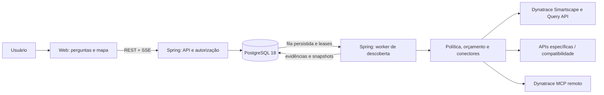

# SDD-001 — Porto Observability Platform / Map

Versão: 0.1 · Data: 28/10/2026 · Estado: proposta para implementação.

Identidade: **Porto → Porto Observability Platform (POP) → Map**. A marca corporativa precede o nome da plataforma e o nome do componente no cabeçalho.

## 1. Resultado esperado

Uma pessoa informa `https://portoseguro.com.br/aplicacao-a`, responde poucas perguntas e recebe um mapa navegável dos componentes conhecidos dessa aplicação. O sistema recupera conhecimento persistido imediatamente, informa sua idade e executa somente as atualizações necessárias e autorizadas pela política. API e MCP acrescentam evidências, relações e sugestões dentro de um trabalho finito.

O público principal é SRE e ERT (Emergency Response Team). A leitura inicial prioriza serviços e triagem, com infraestrutura agrupada e ajuda contextual para cada tipo. O [contrato de legibilidade e ajuda](08-mapa-sre-ert-ajuda.md) é parte obrigatória da experiência.

Cada busca aceita cria uma **SearchSession**. O trabalho remoto é uma **DiscoveryRun**, compartilhável quando escopo, autorização, período e política são compatíveis. O resultado é um **GraphSnapshot** imutável. A sessão de negócio não é uma sessão HTTP, uma conexão SSE ou uma sessão do protocolo MCP.

O mapa representa o que foi observado e com qual abrangência. Uma relação do frontend inteiro não prova que uma rota específica utiliza aquele serviço. Ausência de telemetria não prova ausência de componente.

## 2. Premissas e decisões propostas

| Tema | Baseline desta especificação |
| --- | --- |
| Componentes | Aplicação/frontend, serviços, processos/grupos, hosts, Kubernetes, bancos e dependências externas quando houver evidência |
| Oportunidades | **Prioridade confirmada: problemas de desempenho e resiliência**; novas dependências e lacunas qualificam a análise |
| Dynatrace | **SaaS com Grail e MCP disponíveis**, confirmado pelo usuário; schemas, permissões, licenciamento e protocolo serão homologados |
| Web | Next.js App Router, React, TypeScript e Fluent UI React v9; React Flow encapsulado. Primeira prévia em `web` com dados fictícios |
| Serviço | Java 25 LTS proposto, Spring Boot em linha estável suportada e compatível com o SDK MCP escolhido; versões exatas no spike |
| Persistência | PostgreSQL 18.x, minor suportado fixado no ambiente e verificado em CI |
| Execução | Monólito modular, com API e worker separáveis como perfis/processos da mesma base |
| Atualização | Por necessidade e validade dos dados; sem varredura contínua automática no MVP |
| IA | Enriquecimento opcional e limitado; o mapa básico independe de LLM |
| Hospedagem | A definir; sem assumir AWS, Kubernetes ou um serviço gerenciado de banco |

Estas premissas podem ser revisadas sem alterar os invariantes de isolamento, execução finita e rastreabilidade. O workspace estava vazio, sem código, build ou instruções locais de arquitetura identificadas. A compatibilidade real Java/Spring deve ser validada pela [matriz oficial do Spring Boot](https://docs.spring.io/spring-boot/system-requirements.html).

## 3. Problemas que o desenho resolve

1. Buscas repetidas repetem trabalho caro: reutilizar snapshots e coalescer atualizações concorrentes.
2. Grafo amplo perde utilidade: começar pelo contexto da aplicação e expandir com limites explícitos.
3. Spinner infinito esconde problemas: máquina de estados persistida, prazos e causas de parada.
4. MCP tratado como conexão por usuário gera fragilidade: gerenciar cliente por fronteira de segurança e protocolo efetivamente suportado.
5. IA pode inventar relações: separar observação, associação confirmada e hipótese.
6. URL pode identificar várias aplicações: resolução por evidências e escolha explícita em ambiguidades.
7. Dados antigos parecem atuais: validade e cobertura por camada, não um único selo global.

## 4. Escopo do MVP

Inclui login corporativo, uma organização com múltiplos ambientes Dynatrace, resolução de URL, confirmação de candidatos, mapa progressivo, filtros, sessões, histórico e comparação de snapshots, indicadores RED, problemas Dynatrace no escopo, regras limitadas de desempenho/resiliência, coleta determinística, MCP de leitura habilitado por capability/política, cancelamento, resultados parciais e ledger de consumo. As regras estão no [perfil de desempenho e resiliência](07-desempenho-resiliencia.md).

Ficam para expansão: remediação automática, alterações no Dynatrace, descoberta irrestrita de todo o tenant, inventário oficial/CMDB, faturamento monetário preciso sem tabela contratual, agendamento contínuo e agentes autônomos que escolhem ferramentas arbitrárias. Mapas históricos mostram conhecimento capturado, não reconstroem retroativamente evidência que nunca foi persistida.

## 5. Requisitos normativos

“DEVE” é obrigatório para aceitar o incremento correspondente. “PODE” descreve extensão opcional.

| ID | Requisito |
| --- | --- |
| RF-01 | Cada busca aceita DEVE gerar sessão, exceto retransmissão com a mesma chave de idempotência e mesmo conteúdo. |
| RF-02 | O sistema DEVE procurar e exibir snapshot autorizado compatível, se existir, antes de depender de chamada remota. |
| RF-03 | A chave de recuperação DEVE incluir organização, ambiente Dynatrace, fronteira de autorização e escopo normalizado. |
| RF-04 | A resolução DEVE preservar diferenças de caminho e explicitar o escopo frontend versus rota. |
| RF-05 | Ambiguidade DEVE solicitar seleção, sem escolher silenciosamente o primeiro candidato. |
| RF-06 | A coleta DEVE ser separada em etapas com entradas, saídas, orçamento e checkpoint. |
| RF-07 | Estado, etapa, resultados já disponíveis e motivo de parada DEVEM permanecer consultáveis após recarga. |
| RF-08 | Nenhuma execução DEVE operar sem prazo absoluto, teto de trabalho e orçamento reservado. |
| RF-09 | Filtros, zoom, seleção, reconexão SSE e abertura de histórico NÃO DEVEM iniciar coleta. |
| RF-10 | Mudança de período/escopo ou expansão remota DEVE apresentar impacto e criar nova intenção rastreável. |
| RF-11 | MCP DEVE usar ferramentas permitidas, parâmetros validados e identidade isolada. |
| RF-12 | Falha do MCP DEVE preservar o resultado determinístico e produzir aviso ou resultado parcial. |
| RF-13 | Cada nó, aresta e oportunidade DEVE ter proveniência, janela e nível de evidência. |
| RF-14 | Busca repetida DEVE atualizar camadas vencidas; camadas válidas DEVEM ser reutilizadas com motivo visível. |
| RF-15 | Publicação de snapshot e evento correspondente DEVE ser atômica. |
| RF-16 | Cancelamento DEVE interromper novos despachos e liberar reserva somente quando seu estado for conhecido. |
| RF-17 | Execução concorrente equivalente DEVE ser compartilhada apenas quando autorização e cobertura forem compatíveis. |
| RF-18 | Sessões e snapshots DEVEM permitir comparação entre novos, alterados e não observados novamente. |
| RF-19 | Hipótese produzida por IA NÃO DEVE se tornar aresta observada sem evidência independente. |
| RF-20 | Todo resultado truncado, amostrado, indisponível ou com escopo amplo DEVE ser identificado na tela. |
| RF-21 | O perfil de desempenho/resiliência DEVE distinguir métrica observada, regressão comparável, problema atribuído pelo Dynatrace e hipótese de concentração. |
| RF-22 | O sistema NÃO DEVE inferir indisponibilidade de tráfego zero nem ponto único de falha da existência de um único nó de serviço/host observado. |
| RF-23 | O mapa DEVE abrir com leitura por serviços e contexto de triagem, usando agrupamento antes de tornar rótulos ilegíveis. |
| RF-24 | Todo tipo renderizado DEVE ter ajuda contextual com descrição, exemplo e limites de interpretação, acessível por botão e teclado sem consultas Dynatrace. |
| RF-25 | Grupos DEVEM revelar componentes com problema e sem dados; atualização NÃO DEVE mover foco, seleção ou nós existentes automaticamente. |
| RNF-01 | O sistema DEVE usar credenciais somente no serviço e verificar autorização em toda leitura, exportação e replay. |
| RNF-02 | Chamadas remotas NÃO DEVEM manter transação ou lock de banco abertos. |
| RNF-03 | Reinício do worker DEVE recuperar estados por lease/checkpoint, sem repetição cega de chamada paga. |
| RNF-04 | Limites de tempo, chamadas, volume e consumo DEVEM valer de forma distribuída entre réplicas. |
| RNF-05 | Logs e eventos NÃO DEVEM conter tokens, payloads sensíveis ou query strings de usuários. |
| RNF-06 | A experiência DEVE fornecer navegação por teclado e alternativa textual ao grafo. |
| RNF-07 | Perda de eventos ao vivo NÃO DEVE perder resultado; banco e snapshot são a fonte de recuperação. |

## 6. Arquitetura



A Web nunca acessa credenciais do Dynatrace. A API responde rapidamente com sessão e resultado conhecido. O worker executa o plano limitado. SSE comunica eventos duráveis; reconectar a tela não reconecta o MCP nem recria o plano.

Pacotes propostos por feature:

```text
br.com.porto.popmap
  identity       # autorização e fronteira de compartilhamento
  environment    # credenciais por referência e capacidades do tenant
  application    # catálogo de aplicações e vínculos de URL
  discovery      # plano, estados, leases, cancelamento e orçamento
  topology       # evidências, normalização, snapshots e diferenças
  opportunity    # regras e sugestões com evidências
  exploration    # sessões, filtros salvos, histórico e eventos Web
```

Cada feature expõe contratos públicos pequenos. `discovery` coordena portas como `TopologySource`, `QueryExecutor` e `EnrichmentGateway`; adapters REST/MCP ficam em infraestrutura. Controllers chamam casos de uso, como `StartSearch`, `ResolveCandidate` e `CancelSearch`; queries simples podem usar um query service. Domínio não depende de DTOs do Dynatrace, JPA ou SDK MCP.

A fila inicial reside no PostgreSQL, com claim curto e lease. Outbox/eventos persistidos entregam progresso. Redis, Kafka e motor externo de workflows não são requisitos do MVP; a necessidade será medida por contenção, throughput e recuperação.

## 7. Decisões arquiteturais

| ADR | Decisão | Consequência e revisão |
| --- | --- | --- |
| ADR-01 | Sessão, execução e snapshot separados | Permite histórico individual com coleta compartilhada e cancelamento por assinante. |
| ADR-02 | Topologia determinística antes de enriquecimento | Resultado útil sem IA; revisar enriquecimento após medir ganho por consumo. |
| ADR-03 | Smartscape preferencial e compatibilidade explícita | Evita começar pela API em migração; validar capacidades em cada tenant. |
| ADR-04 | Monólito modular com worker separável | Menor operação inicial; extrair apenas com escala ou isolamento comprovados. |
| ADR-05 | Grafo relacional no PostgreSQL | Não exige graph database para expansão rasa e snapshots limitados. |
| ADR-06 | SSE com replay no banco | Progresso recuperável; sem depender de conexão aberta para vida do job. |
| ADR-07 | MCP com catálogo permitido e plano finito | Sem loop livre de agente; ferramentas opacas ficam desabilitadas até terem limite verificável. |
| ADR-08 | Nenhuma renovação automática de orçamento | “Continuar descoberta” é nova sessão vinculada, com novo plano e limite. |

O Dynatrace documenta a migração de entidades clássicas e recomenda Smartscape on Grail para novas consultas. Isso fundamenta ADR-03, condicionado ao ambiente real. [Monitored entities API](https://docs.dynatrace.com/docs/dynatrace-api/environment-api/entity-v2).

## 8. Critério de conclusão desta especificação

O SDD está suficientemente definido para começar quando produto, integração e operação concordarem com os invariantes e com os gates do [plano](05-aceite-plano.md). SaaS/Grail/MCP e a prioridade de desempenho/resiliência foram confirmados pelo usuário. O framework Web foi definido como Next.js/React/Fluent 2; a [compatibilidade com o template](09-compatibilidade-template-web.md) documenta a primeira implementação. Acesso efetivo ao tenant, preços, protocolo MCP e SLOs/baselines continuam como entradas do spike. Esta entrega não afirma integração validada ou prontidão de produção.
